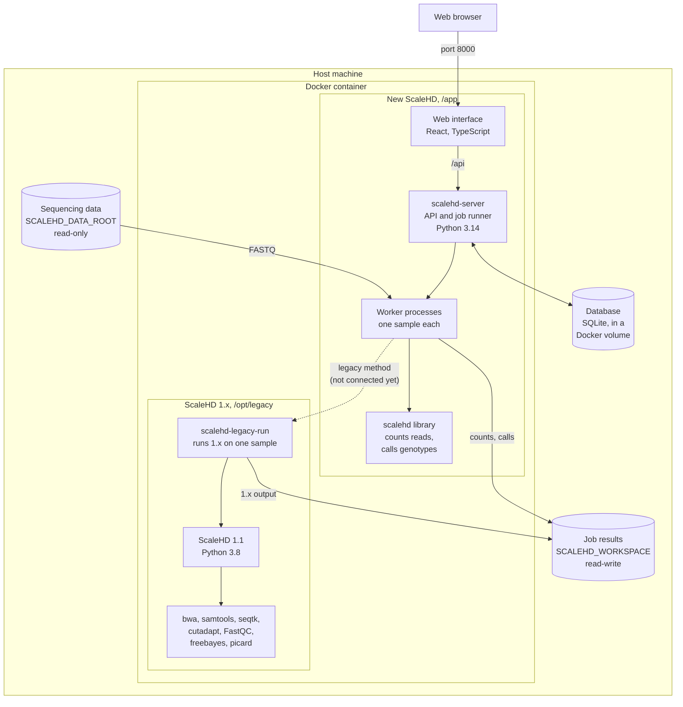

# ScaleHD

> [!WARNING] 
> I'm re-writing ScaleHD as a hobby project. If you are looking for the original ScaleHD, it's either been forked by others, or check the legacy folder within the repository. Eventually the legacy genotyping method will be usable from the web interface within this version of ScaleHD.

Genotyping of the Huntington disease *HTT* CAG/CCG repeat from paired-end amplicon
sequencing. This is a ground-up rewrite. The previous ScaleHD implementation
is kept for reference in [`legacy/`](legacy/). Looking back at old work is embarrassing
but everyone starts their professional journey somewhere. Hopefully this implementation
is more professional.

I am no longer working with the Monckton research group at University of Glasgow 
anymore so this is mostly just a hobby project that may or may not go anywhere.

## Project layout

Everything runs in one Docker image. The web interface talks to the server's API, the
server hands each sample to a worker process, and results go to the workspace folder on
the host. ScaleHD 1.x sits in `/opt/legacy` within the container, with its own Python (and the binaries it needs).
Once it's connected to the front-end, it will run one sample at a time through `scalehd-legacy-run`.



## Quick start (entire stack (web, api, backend))

For Users:

Needs Docker, Docker Compose and git ([DOCKER.md](docs/DOCKER.md) has installing them from
scratch). The paths below are the examples `.env.example` starts with; use your own.

```sh
git clone https://github.com/helloabunai/ScaleHD.git
cd ScaleHD
cp .env.example .env    # then set SCALEHD_DATA_ROOT and SCALEHD_WORKSPACE in it
sudo mkdir -p /srv/scalehd/data /srv/scalehd/workspace
sudo chown 1000 /srv/scalehd/workspace    # the container's user writes results here
docker compose up -d --build
```

Then open <http://localhost:8000>. The first account you register is the admin, and
"Run demo" on the home page runs simulated samples end to end. Reaching it from other
computers, the other settings and updating are in [DOCKER.md](docs/DOCKER.md).

For Development:

Needs [uv](https://docs.astral.sh/uv/) (Python 3.13+) and Node.js with npm (the Docker
image builds with Node 24).

```sh
git clone https://github.com/helloabunai/ScaleHD.git
cd ScaleHD
uv sync
tools/dev.sh    # API on port 8000, web interface at http://localhost:5173
```

`tools/dev.sh` installs the web interface's packages when needed, reloads on code
changes, and keeps its own database (`data/scalehd.db`). Stop the Docker stack first
(`docker compose stop`), as both use port 8000. Tests, checks and the pre-push hook are
in [DEVELOPMENT.md](docs/DEVELOPMENT.md).

## Quick start (command line tool, alone)

Requires [uv](https://docs.astral.sh/uv/) and Python 3.13+.

```sh
uv sync
uv run scalehd simulate -a 17_1_1_7_2 -a 43_1_1_7_2 -n 20000 -o scratch --name s1
uv run scalehd count scratch/s1_R1.fastq.gz scratch/s1_R2.fastq.gz -o scratch/s1.counts.json
uv run scalehd call scratch/s1.counts.json -o scratch/s1.call.json
```

`scalehd genotype R1 R2` counts and calls in one step.

`simulate` writes paired FASTQ plus a `.truth.json`. Its model covers PCR stutter,
somatic expansion, length bias, sequencing errors that rise along the read, spacers
and adapter read-through, so the pipeline can be tested before real data is
available.

Read more documentation in the following:

- [Running the server with Docker](docs/DOCKER.md): installing Docker from scratch, the
  folders and `.env` settings, starting it, reaching it from other computers, updating
- [Web interface and API](docs/WEB-INTERFACE.md): what works (so far)
- [Using real FASTQ files](docs/USING-FASTQ.md): what the input should look like, one sample
  or a batch, reading the result, checking the results, etc
- [What's different](docs/WHATS-DIFFERENT.md): how this rewrite differs from ScaleHD 1.x
- [The genotyping model](docs/MODEL.md): the statistical model behind the new model-based
  genotyping, its equations, assumptions and how a call's confidence is calculated.
- [Validation export](docs/VALIDATION-EXPORT.md): for checking the model vs real data that can't 
  be exported to non-staff (me)
- [Development](docs/DEVELOPMENT.md): tests and checks, the pre-push hook, the dev server, the
  repository layout
- [Ideas/planned features](docs/IDEAS.md)

## Licence

MIT, see [LICENSE](LICENSE).
